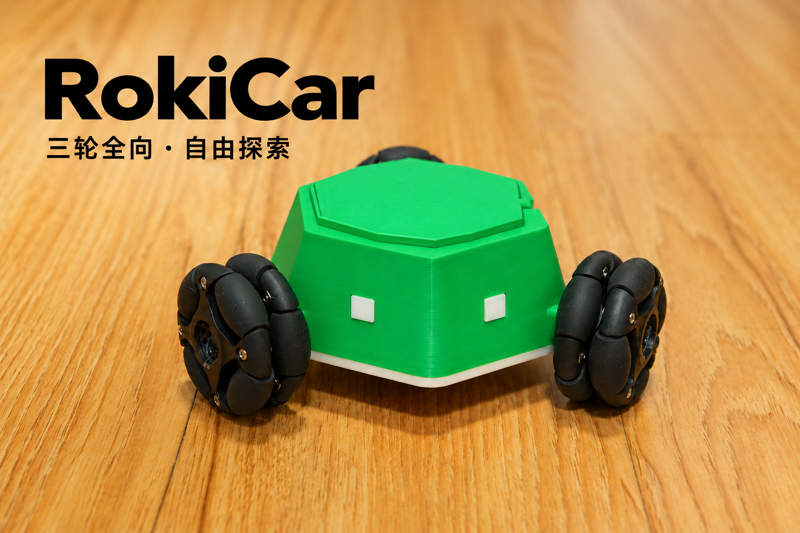
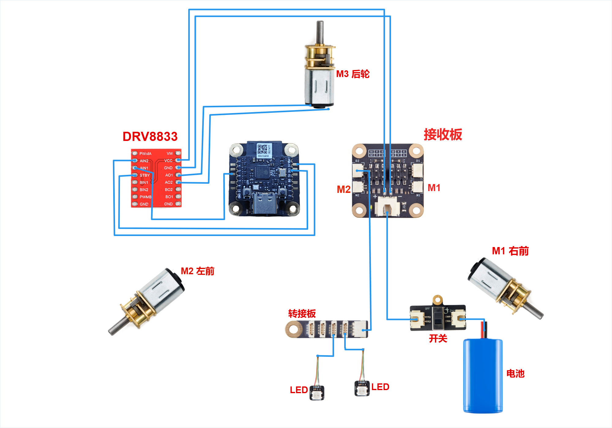
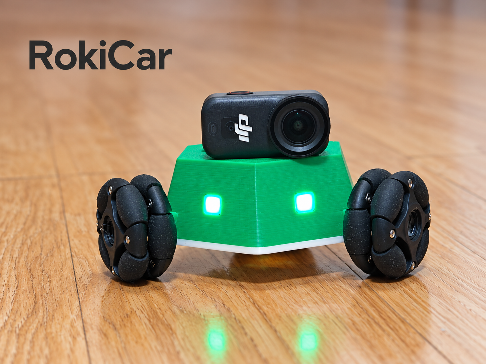

# RokiCar

[简体中文](README.md) | **English**

A hexagonal robot car with three omni wheels. It can move forward, backward and sideways, or rotate in place. Control it from your phone and print the enclosure on a regular FDM printer.

## Downloads

- [Build guide PDF (English)](https://github.com/yinbaozong/RokiCar/releases/latest/download/RokiCar-Replication-Guide-English.pdf): parts, purchasing links, wiring, assembly and firmware upload instructions. Start here.
- [Android app](https://github.com/yinbaozong/RokiCar/releases/latest/download/RokiCar-Controller-v1.22-debug.apk)
- [Car firmware](https://github.com/yinbaozong/RokiCar/releases/latest/download/RokiCar-Firmware-20261008.zip)
- [3D models](https://github.com/yinbaozong/RokiCar/releases/latest/download/RokiCar-V8-Models.zip)

## Parts

**Use three of the 47 mm omni wheels recommended in the PDF.** The enclosure and wheel clearance are designed around these wheels. Different wheel sizes or designs may require changes to the model. You will also need couplers that fit the wheels and motor shafts.

Other main parts include three 6 V / 200 rpm N20 motors, one DRV8833 motor driver, a CyberBrick core board and receiver board, a battery, a switch and LEDs. You can buy the all-in-one kit or purchase the parts individually. The PDF includes the full parts list and purchasing links for selected components; check the specifications and connectors before ordering.

## Wiring

M1 is the front-right motor, M2 is the front-left motor and M3 is the rear motor. Connect the LED adapter board to D2. Follow the PDF for wiring and firmware upload instructions. For the first test, lift the wheels off the ground and check motor direction and stopping before driving.

## Make it your own

The car models, software and hardware documentation are all open source. Feel free to modify the design, add accessories and build on the project. Adapt the top cover to mount a camera, sensors or other modules, and give RokiCar new capabilities of your own. The camera and related upgrades are optional additions you install yourself.

Share your builds, modifications and ideas. If you have any questions, [open an issue](https://github.com/yinbaozong/RokiCar/issues) or email me at [yinbaozong@163.com](mailto:yinbaozong@163.com).
